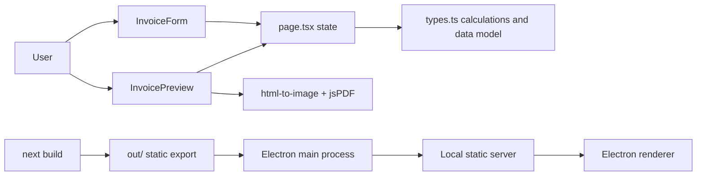

# Bilquo Architecture

Bilquo is intentionally small and front-end heavy. There is no API server or database.

## High-Level Shape

## Next.js Layer

- `src/app/page.tsx` owns the document state.
- `src/app/layout.tsx` defines the document shell and metadata.
- `src/app/components/` contains the interactive UI pieces.
- `src/app/types.ts` defines the invoice model and math helpers.
- `src/app/globals.css` applies the global visual system.

The page is a client component, which keeps the UI interactive without a backend.

## Component Responsibilities

- `InvoiceForm` mutates the invoice, quote, or receipt fields.
- `InvoicePreview` renders the document and handles PDF export.
- `LogoUploader` converts an uploaded image into a data URL.
- `TemplateSelector` switches between preview layouts.
- `icons.tsx` provides the inline SVG icons used across the UI.

## Data Flow

1. The page initializes a single `InvoiceData` object.
2. Form changes update the shared state in `page.tsx`.
3. The preview reads the same state and recalculates totals immediately.
4. PDF export renders the preview DOM into an image and packages it into a PDF.

## Static Export Strategy

`next.config.ts` uses `output: "export"`, which means the project builds to a static `out/` directory.

Why this matters:

- the app can be hosted on any static file server
- the same build can be wrapped in Electron
- no Node.js runtime is required for the UI itself

## Desktop Packaging

The desktop shell is in `desktop/`.

- `desktop/static-server.cjs` serves the exported `out/` directory over localhost.
- `desktop/main.cjs` launches Electron and points the window at that local server.
- `electron-builder` packages the app into an installer or native package for the current OS.

This approach is more efficient than shipping a full Next.js server because the UI is already static.

## Why This Is The Right Packaging Path

For this codebase, the executable should be built on top of the static export rather than a bundled Next server because:

- the app does not depend on server-side data fetching
- the preview and export logic already run in the browser
- static export keeps the runtime small and predictable
- Electron gives the fastest route to desktop packaging on Windows, macOS, and Linux

## Current Limits

- There is no persistent storage yet.
- There is no authentication or multi-user backend.
- The app is designed for a single local operator session.

## Build Pipeline

1. `npm run build`
2. `out/` is generated by Next.js
3. `npm run build:desktop`
4. Electron-builder packages the app into `release/`
5. `.github/workflows/desktop-build.yml` runs the same packaging flow on Windows, macOS, and Linux runners

Platform-specific package scripts are also available:

- `npm run build:desktop:win`
- `npm run build:desktop:mac`
- `npm run build:desktop:linux`

## Future Extensions

If the project later needs persistence, teams, or synced documents, the next step would be to add a backend and storage layer. Until then, the static export plus desktop wrapper is the simplest correct deployment model.
